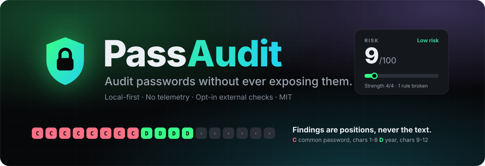
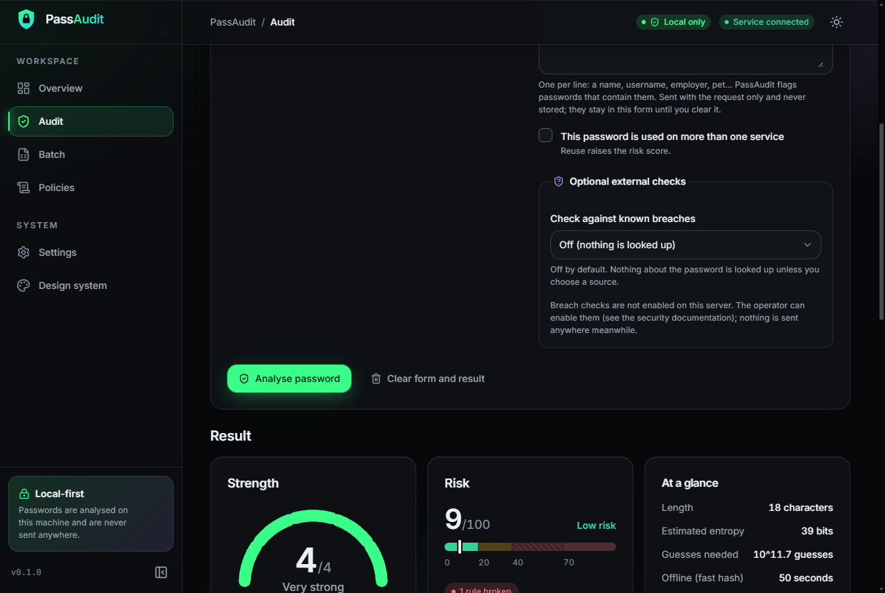
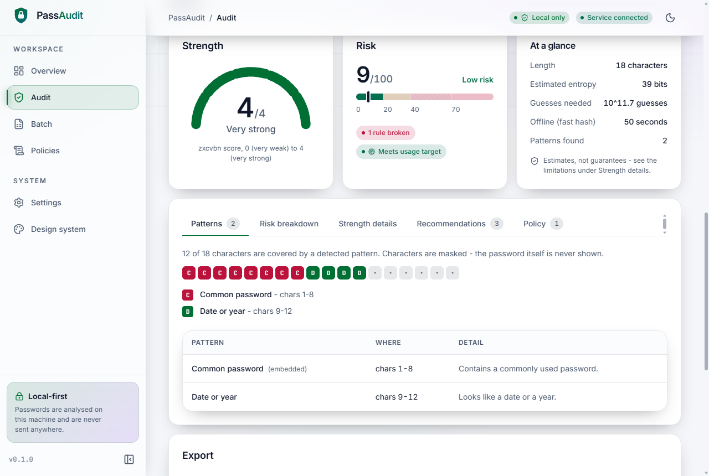
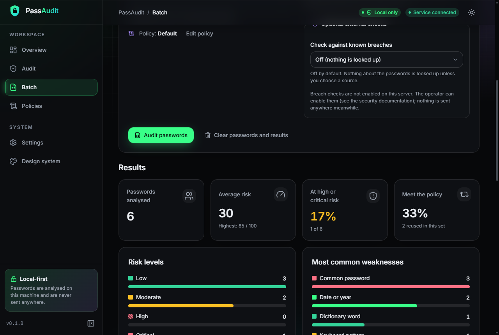
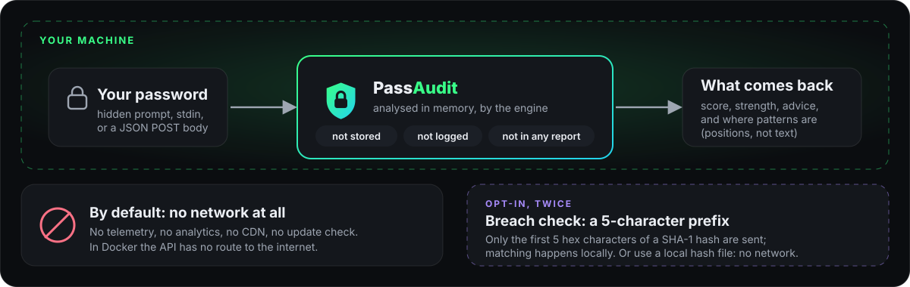
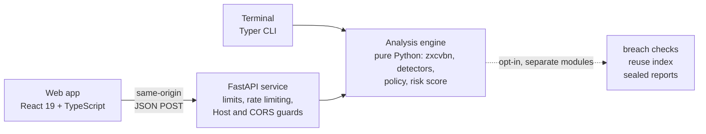

<div align="center">



<br>

[](LICENSE)
[](docs/installation-linux.md)
[](docs/installation-linux.md#option-c-full-development-setup)
[](docs/docker.md)
[](docs/privacy.md)
[](docs/privacy.md)

**[Quick start](#-quick-start)** &nbsp;·&nbsp;
**[Features](#-what-it-does)** &nbsp;·&nbsp;
**[Privacy](#-private-by-construction)** &nbsp;·&nbsp;
**[CLI](docs/cli.md)** &nbsp;·&nbsp;
**[API](docs/api.md)** &nbsp;·&nbsp;
**[Docs](#-documentation)**

</div>

<br>

**PassAudit** tells you how a password would be attacked, what weakens it, and how to fix it, without
the password ever being stored, logged, or sent anywhere. Use it from a web app, a command line, or a
local HTTP API; all three run the same engine on your own machine.

<p align="center">
  
  
</p>

## ⚡ Quick start

<table>
<tr>
<td width="34%" valign="top">

### 🐳 Docker
Any OS. The web app is published on `127.0.0.1` only.

```bash
docker compose up --build -d --wait
```

Open <http://127.0.0.1:8080>.
Stop: `docker compose down`.

[Docker guide →](docs/docker.md)

</td>
<td width="33%" valign="top">

### 🐧 Linux / macOS
Python 3.12+, no Node.js needed.

```bash
python3 -m venv .venv
.venv/bin/pip install .
.venv/bin/passaudit audit
```

[Linux guide →](docs/installation-linux.md)

</td>
<td width="33%" valign="top">

### 🪟 Windows
PowerShell, Python 3.12+.

```powershell
py -3.12 -m venv .venv
.\.venv\Scripts\python.exe -m pip install .
.\.venv\Scripts\python.exe -m passaudit audit
```

[Windows guide →](docs/installation-windows.md)

</td>
</tr>
</table>

`passaudit audit` asks for the password at a hidden prompt. To script it, pipe it in (never as an
argument, which would land in process lists and shell history):

```bash
printf '%s\n' 'correct horse battery staple' | .venv/bin/passaudit audit --stdin -f json
```

Each guide was followed literally on a clean machine; the results are in the
[verification record](docs/release-checklist.md#verification-record).

## 🔍 What it does

<table>
<tr>
<td width="33%" valign="top">

#### Honest analysis
Strength from [zxcvbn](https://pypi.org/project/zxcvbn/), plus dictionary words, names, dates, keyboard
walks, sequences and repeats, a transparent **0-100 risk score**, and fixed-text advice. Entropy is
shown *with its limits*.

</td>
<td width="33%" valign="top">

#### Positions, never text
Findings say *where* a weakness is (`chars 1-8`), never *what* it matched. Nothing in a result, report
or log can reveal the password.

</td>
<td width="33%" valign="top">

#### Policy you can read
Rule-by-rule pass/fail against built-in profiles (`default`, `nist-inspired`, `enterprise`,
`high-security`, `passphrase`, ...) or your own.

</td>
</tr>
<tr>
<td valign="top">

#### Batch audits
Paste or upload a list: reuse is detected, risk is summarised, and a **sanitized, sealed** JSON/CSV
report is exported.

</td>
<td valign="top">

#### Breach checks, opt-in
A local hash file needs no network. The online check sends only a **5-character hash prefix**, and
only if you enable it twice. A failed lookup is *unchecked*, never *clean*.

</td>
<td valign="top">

#### Authorised reuse audits
Compare against local data sets through a keyed HMAC index. PassAudit makes you state your
authorisation and records it in every report.

</td>
</tr>
</table>

<p align="center">
  
</p>

## 🔒 Private by construction

PassAudit exists to inspect passwords, so its privacy rules are structural: the code *cannot* do the
risky thing, and tests fail if it ever does.

<p align="center">
  
</p>

| | |
| --- | --- |
| **Never stored or logged** | Analysed in memory. No database, no log of bodies, URLs or headers; errors never echo input. The browser keeps only UI preferences |
| **Never in an argument or URL** | The CLI has no `--password` option; the API accepts passwords only in JSON `POST` bodies and rejects query strings |
| **No network by default** | No telemetry, CDN, fonts or update checks. A strict Content-Security-Policy (`connect-src 'self'`) makes the browser enforce it |
| **Local only** | The API has no authentication, so it binds to loopback, validates `Host`, and in Docker sits on a network with no route out |
| **Reports can't leak** | Whitelisted fields, scanned for every submitted secret before they are written, and refused if one appears |

Read the [privacy guide](docs/privacy.md) for the plain-language version and the
[security model](docs/security.md) for the threat model, the controls and the test that verifies each.

## 🧩 Three ways in, one engine



The engine has no web or network code and cannot import the optional modules; the only module
allowed to open a socket is `breach/providers.py`. Architecture tests enforce both. See the
[architecture](docs/architecture.md), the [engine guide](docs/analysis-engine.md) and the
[decision records](docs/adr/).

## 🛠 Using it

| | Command | Reference |
| --- | --- | --- |
| **Audit one password** | `passaudit audit` · Web: *Audit* | [CLI](docs/cli.md) |
| **Audit many** | `passaudit batch passwords.txt -f json -o report.json` · Web: *Batch* | [CLI](docs/cli.md) |
| **Check a policy** | `passaudit policy check --profile high-security` · Web: *Policies* | [CLI](docs/cli.md) |
| **Call the API** | `POST /api/v1/audit`, `/audit/batch`, `/policy/validate`, `/audit/report` | [API](docs/api.md) |
| **Check breaches** | `--breach local --breach-file pwned-sorted.txt` (no network) or `--breach online --allow-external` | [Privacy](docs/privacy.md) |
| **Audit reuse** | `passaudit reuse build --source hr=hr.txt ... --confirm-authorized` | [Security](docs/security.md) |

Exit codes make the CLI scriptable: `0` passed, `1` failed the policy or risk gate, `2` usage error,
`3` input error, `4` report could not be written.

```bash
curl -s http://127.0.0.1:8000/api/v1/audit -H 'Content-Type: application/json' \
     -d '{"password": "Summer2024!", "policy": {"min_length": 14}}'
```

## ✅ Quality

Measured on the current code. Method and findings are in the [QA report](docs/qa-report.md).

| | |
| --- | --- |
| **Backend** | 1211 tests, 98% line + branch coverage; `ruff`, `mypy --strict`, `bandit` clean |
| **Frontend** | 299 tests (Vitest, axe-core); ESLint, Prettier and `tsc` clean |
| **Platforms** | Windows 11 (Python 3.12) · Ubuntu 24.04 (3.12) · Debian-based `python:3.13` and `3.14` · Docker |
| **Security** | `pip-audit` and `npm audit` clean · 16,000 fuzzed requests with no 5xx and no leak · no password in any log at debug level · CSP verified in a real browser |
| **Accessibility** | axe-core with every rule, both themes and a phone viewport: 0 violations |

CI (`.github/workflows/ci.yml`) runs the same gate on Linux and Windows, audits dependencies and
smoke-tests the containers. It has not run yet: it needs the repository to exist on GitHub.

## ⚠️ Limitations

PassAudit is an aid, not an oracle. The full list is in [Known gaps](docs/security.md#known-gaps).

* **Local use only.** There is no authentication. Do not expose the API or the web app to a network.
* **Estimates, not guarantees.** Strength and entropy are models. "Not found in a breach" is not
  "safe", and a failed lookup is reported as *unchecked*.
* **Small bundled dictionaries.** The word, name and common-password lists are modest samples;
  supply larger lists for serious audits.
* **Memory.** Python and JavaScript cannot wipe strings; malware, browser extensions and crash dumps
  are out of scope.
* **Platforms.** Verified on Windows 11, Ubuntu 24.04 and in Docker. macOS and ARM are untested.

## 📚 Documentation

| | |
| --- | --- |
| **Install and run** | [Windows](docs/installation-windows.md) · [Linux](docs/installation-linux.md) · [Docker](docs/docker.md) |
| **Reference** | [CLI](docs/cli.md) · [HTTP API](docs/api.md) |
| **How it works** | [Architecture](docs/architecture.md) · [Analysis engine](docs/analysis-engine.md) · [Frontend](docs/frontend.md) · [ADRs](docs/adr/) |
| **Trust** | [Security model](docs/security.md) · [Privacy](docs/privacy.md) · [QA report](docs/qa-report.md) |
| **Project** | [Development](docs/development.md) · [Contributing](CONTRIBUTING.md) · [Release checklist](docs/release-checklist.md) · [Changelog](CHANGELOG.md) |

## 🧑‍💻 Development

```bash
make setup && make check                    # Linux / macOS
.\scripts\setup.ps1; .\scripts\check.ps1    # Windows PowerShell
```

`make help` lists the targets; the Windows scripts are described in
[docs/development.md](docs/development.md). Please read [CONTRIBUTING.md](CONTRIBUTING.md) first: a
change that breaks a privacy guarantee is a bug even when every test passes.

## 🛡 Security

Report vulnerabilities privately, as described in [SECURITY.md](SECURITY.md). Please do not open
public issues containing exploit details or real credentials.

## 📄 License

[MIT](LICENSE). Third-party components and their licenses are listed in
[THIRD_PARTY_NOTICES.md](THIRD_PARTY_NOTICES.md).

<div align="center">
<sub>Built so that the safest place for your password is the one it never leaves.</sub>
</div>
